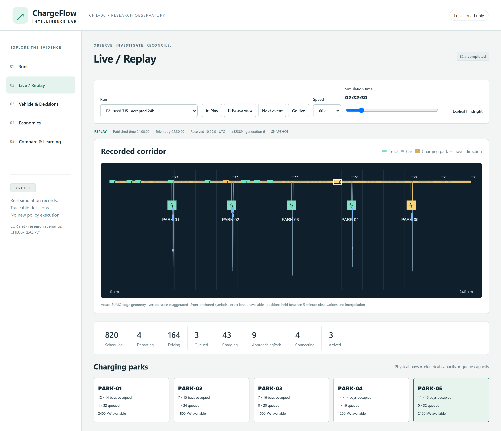
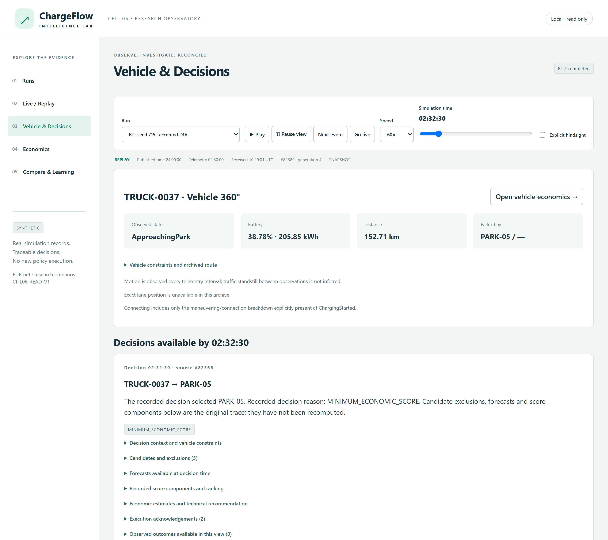
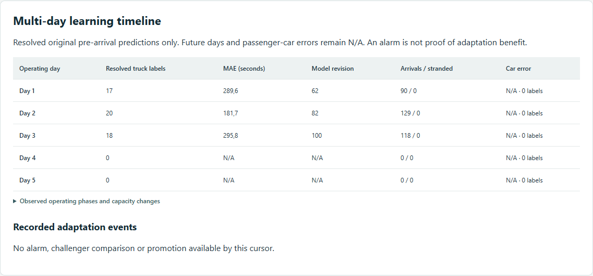

# ChargeFlow Intelligence Lab

ChargeFlow Intelligence Lab is a traffic and charging digital twin for electric fleets. It simulates traffic on a synthetic motorway with Eclipse SUMO and records what happens when vehicles choose a charging park, queue for a compatible bay, and return to the road.



## What it shows

- **Traffic and charging.** Replay vehicle movements and inspect battery state, queues, and charging sessions.
- **Charging decisions.** Trace why a truck chose a certain park and how estimated waiting time, charging price, and delivery timing influenced that choice.
- **Learning across days.** Inspect how the model learns from waiting times once they are observed, and how an alternative model can be evaluated before replacing the current one.





The screenshots are from recorded synthetic runs. The compact scenario below is a quick way to try the replay workflow. The decision and learning screenshots come from larger runs.

## Run the demo on Windows

Install Python 3.12 and the [.NET 10 SDK version specified in `global.json`](global.json). From the repository root, run the following in PowerShell:

```powershell
python -m venv .venv
.\.venv\Scripts\python.exe -m pip install -r adapters/sumo-bridge/requirements.txt
dotnet restore --locked-mode
dotnet build -c Release --no-restore

dotnet src/CFIL.Runner/bin/Release/net10.0/CFIL.Runner.dll run scenarios/smoke-v1.json --output runs/demo-smoke --python .venv/Scripts/python.exe
dotnet run --project src/CFIL.Web -c Release --no-build --no-launch-profile -- --urls http://127.0.0.1:5186
```

Open [the local explorer](http://127.0.0.1:5186), select **Demo · SUMO smoke scenario**, and move the timeline to inspect the run. The simulation requires a fresh output directory. For a second run, choose a new directory and update its path in [`observation/catalog.json`](observation/catalog.json). The Python adapter installs SUMO and TraCI through its pinned requirements.

## Snapshot status

This public demonstration captures the CFIL-07 closeout dated 18 November 2026. The first full-size run reached all 120 simulated hours. A memory error during finalization left the economic report and final validation incomplete. The full comparison matrix and formal CFIL-07 acceptance remain open. Traffic demand and tariffs are synthetic.
